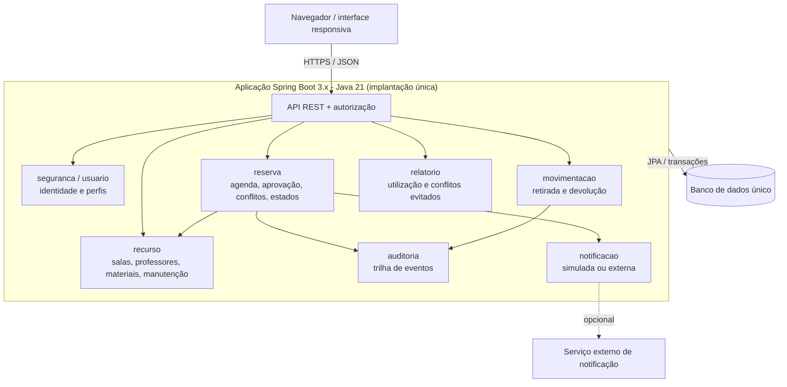

# Organização de Recursos

> **Resumo:** Sistema para gerenciar a alocação de salas, professores e materiais, impedindo conflitos de horário e demonstrando, com evidências objetivas, a qualidade, a segurança, a rastreabilidade e o desempenho da solução.

## Contexto Acadêmico

- **Instituição:** Senac
- **Curso:** Análise e Desenvolvimento de Sistemas
- **Semestre:** 2026.2
- **Disciplina(s):** Qualidade de Software

A especificação oficial do projeto está em:
[especificacao-projeto](https://afonsolelis.github.io/aulas_senac/pages/qualidade2/especificacao-projeto.html)

> **Convenção deste documento:** o que é exigência do professor aparece como "oficial" ou "obrigatório". O que aparece como "proposta" ou "recomendação" é sugestão da equipe, sujeita a aprovação em ADR. Nada aqui indica que um requisito já esteja implementado.

## Integrantes da Equipe

| Nome | GitHub | Papel/Foco |
|---|---|---|
| Gabriel Silva Gomes | [@jovemOG-Dev](https://github.com/jovemOG-Dev) | Reservas e regras de domínio |
| Gabriel Rodrigues Fausto | [@gabriel-fausto](https://github.com/gabriel-fausto) | Recursos, modelo de dados e persistência |
| Marcos Boé | [@marcosboe](https://github.com/marcosboe) | Frontend, experiência de uso e testes E2E |
| Débora dos Santos | [@debbySantos](https://github.com/debbySantos) | Segurança, auditoria, CI e qualidade transversal |

O responsável por um módulo coordena sua implementação, mas testes, revisão e documentação são compartilhados: nenhum integrante é o único a testar ou revisar o próprio código.

## Escopo do Sistema

O sistema atende a três perfis de acesso:

- **Solicitante:** professor ou coordenador que consulta a disponibilidade e cria, altera ou cancela reservas próprias.
- **Responsável:** aprova solicitações de recursos restritos, valida a alocação de docentes e acompanha retiradas e devoluções de materiais.
- **Administrador:** gerencia salas, professores, materiais, usuários, bloqueios e períodos de manutenção.

### Requisitos funcionais (oficiais)

| RF | Descrição | Responsáveis |
|---|---|---|
| RF01 | Autenticação e autorização por perfil | Débora, Marcos |
| RF02 | Cadastro e consulta de salas, professores e materiais | Fausto, Marcos |
| RF03 | Pesquisa por tipo, capacidade, localização, competência e disponibilidade | Fausto, Silva, Marcos |
| RF04 | Criação, alteração e cancelamento de reservas | Silva, Marcos, Débora |
| RF05 | Detecção de sobreposição de horários, inclusive de professor | Silva, Fausto |
| RF06 | Proteção contra dupla reserva simultânea | Silva, Fausto, Débora |
| RF07 | Aprovação obrigatória para recursos restritos | Silva, Débora, Marcos |
| RF08 | Bloqueio de recursos em manutenção | Fausto, Silva |
| RF09 | Retirada e devolução de materiais e equipamentos | Fausto, Marcos, Débora |
| RF10 | Histórico auditável de mudanças | Débora e autores dos módulos |
| RF11 | Notificação simulada ou integração externa | Débora, Silva, Marcos |
| RF12 | Relatórios de utilização, carga horária e conflitos evitados | Silva, Fausto, Marcos |
| RF13 | Interface responsiva e mensagens de erro compreensíveis | Marcos, Débora |
| RF14 | Documentação da API ou dos fluxos públicos | Marcos e equipe |

Os códigos RF01 a RF14 são de uso interno da equipe: a especificação oficial numera os requisitos de 1 a 14. Os critérios de aceitação ficarão em `docs/requisitos/`.

### Ciclo de vida de uma reserva

Sequência principal oficial: `SOLICITADA → APROVADA → EM_USO → CONCLUÍDA`, com os estados alternativos `REJEITADA`, `CANCELADA` e `NÃO_COMPARECEU`. A matriz completa de transições (quem, quando, pré-condições) está em análise pela equipe.

### Regras obrigatórias

- O horário final é posterior ao inicial.
- Reservas do mesmo recurso (sala, material ou professor) não se sobrepõem, inclusive na agenda do professor.
- Recurso em manutenção não pode ser reservado.
- Duas solicitações simultâneas e conflitantes produzem uma única reserva aceita.
- Somente o Responsável aprova recursos restritos.
- Reserva iniciada não pode ser apagada, e toda mudança de estado gera auditoria.

## Tecnologias Utilizadas

**Definidas pela especificação**

- **Linguagem e framework:** Java 21 e Spring Boot 3.x
- **Testes:** JUnit 5, Testcontainers e WireMock
- **Qualidade e integração contínua:** GitHub Actions, JaCoCo e SonarCloud
- **Testes de carga:** JMeter

**Propostas e decisões pendentes** (cada uma será registrada em ADR em `docs/arquitetura/adr/`)

| Decisão | Situação | Ponto em aberto |
|---|---|---|
| Frontend | Direção: HTML, CSS e JavaScript simples, consumindo a API | Como será servido e qual ferramenta fará os testes E2E |
| Banco de dados | Proposta: PostgreSQL (relacional e transacional) | Forma de hospedagem e execução local |
| Build | Proposta: Maven | Confirmar antes de criar o `pom.xml` definitivo |
| Autenticação | Sem decisão | Mecanismo de sessão ou token; uso apenas local ou publicado |
| Proteção contra dupla reserva | Sem decisão | Locks transacionais e/ou restrições do banco |
| Modelo de materiais | Sem decisão | Itens individuais ou controle por quantidade |

Onde este documento cita PostgreSQL ou Maven, trata-se de recomendação a validar, não de imposição do enunciado. Nenhum componente que dependa de tecnologia não aprovada deve ser construído.

## Arquitetura e Documentação

**Estado: PROPOSTA, aguardando ADRs.**

O backend é um **monólito modular**: uma única aplicação Spring Boot, implantada como uma unidade, com módulos de negócio organizados internamente. O frontend é apenas um cliente da API: validações visuais não substituem a validação e a autorização feitas no servidor. A separação em pastas não transforma o backend em microsserviços.



Módulos e responsáveis:

| Módulo | Responsável principal | Observação |
|---|---|---|
| `reserva` | Gabriel Silva Gomes | Disponibilidade, conflitos, transições e aprovação |
| `recurso`, `movimentacao` | Gabriel Rodrigues Fausto | Cadastros, manutenção, persistência e movimentações |
| `seguranca`, `auditoria`, `notificacao` | Débora dos Santos | Perfis, permissões, trilha auditável e CI |
| `frontend` | Marcos Boé | Telas, integração com a API e testes E2E |
| `relatorio` | Compartilhado | API por Silva e Fausto, telas por Marcos |

Princípios de arquitetura:

- A regra de conflito de horários fica em um serviço central, reutilizado por criação, alteração, pesquisa de disponibilidade e manutenção.
- A proteção contra dupla reserva é feita no backend, dentro de uma transação, e provada por teste automatizado com concorrência real e banco em container. "Consultar e depois gravar" não é suficiente.
- Toda transição de estado é autorizada, validada pelo domínio e auditada.
- Módulos expõem contratos definidos e não consultam diretamente as tabelas uns dos outros sem acordo documentado.
- Datas seguem ISO 8601 com fuso explícito, e erros seguem um formato padronizado, sem expor detalhes internos.

Estrutura de diretórios prevista, a confirmar. Os diretórios existentes do AIOX são preservados, sem renomear:

```
backend/
  src/main/java/br/senac/recursos/
    config/
    seguranca/ usuario/
    reserva/ recurso/ movimentacao/ auditoria/ notificacao/ relatorio/
    shared/
  src/test/java/br/senac/recursos/
    unit/ integration/ api/ concurrency/
frontend/               <-- HTML, CSS e JS (estrutura a confirmar)
tests/                  <-- E2E, desempenho (JMeter) e evidências
docs/                   <-- requisitos, ADRs, API, testes e qualidade
.github/workflows/      <-- integração contínua
```

A pasta `docs/` reúne a documentação técnica e passará a incluir:

- Requisitos, regras de negócio e critérios de aceitação
- Matriz de rastreabilidade (`RTM.md`)
- Diagramas de contexto, componentes e sequências críticas
- Decisões de arquitetura (ADRs)
- Documentação da API ou dos fluxos públicos
- Plano e relatório de testes
- Plano e resultado do teste de carga
- Registro de defeitos e relatório final de qualidade

## Qualidade e Testes

| Indicador | Meta |
|---|---|
| Cobertura de linhas | 80% ou mais |
| Cobertura de branches | 70% ou mais |
| Requisitos críticos na RTM | 100% |
| Bugs ou vulnerabilidades críticos | Zero |

Tipos de teste previstos: unitários e parametrizados (JUnit 5), integração com banco real (Testcontainers), API em caixa-preta, integração externa isolada (WireMock), ponta a ponta, concorrência, carga (JMeter) e ao menos uma funcionalidade desenvolvida com TDD ou BDD. Mocks são usados apenas em testes unitários isolados.

Os testes e a pipeline rodam em pull requests. Cobertura alta, sozinha, não é critério de qualidade: os testes precisam verificar regras, erros, autorização e concorrência.

## Como Contribuir

1. Abra uma Issue para cada mudança pequena e verificável, indicando o requisito relacionado e os critérios de aceite.
2. Crie uma branch por alteração, com nomes como `feature/rf06-concorrencia`, `test/rf07-aprovacao`, `docs/adr-banco` ou `fix/...`.
3. Combine o contrato entre módulos (DTOs, estados, formato de data e erros) antes de integrações que cruzem responsabilidades.
4. Abra um pull request com contexto, requisitos, evidências de testes e atualização da documentação.
5. Peça revisão de outro integrante e aguarde a pipeline concluir.
6. Nunca versione `.env`, credenciais, arquivos locais de banco ou relatórios temporários.

Cada decisão relevante é registrada em um ADR, com contexto, opções avaliadas, decisão, consequências e riscos.

**Definição de pronto:** uma funcionalidade só está pronta quando atende ao requisito e à regra de negócio (casos válidos, inválidos e de autorização), tem testes executados, com código crítico não dependendo só de mock, tem documentação, RTM e riscos atualizados com evidência reproduzível, e teve o PR revisado com a pipeline verde.

**AIOX:** a base inicial é preservada. Antes de adaptar a estrutura proposta, inventariar os arquivos existentes e seus possíveis conflitos com `backend/`, `frontend/` e `docs/`. Código gerado por agentes entra sempre via PR revisável, com testes executados e documentação.

## Estado do Projeto

O projeto está na fase de planejamento e alinhamento. Ainda não há aplicação executável, e nenhum requisito foi marcado como implementado.

Decisões de domínio em aberto:

- Uma solicitação pendente (`SOLICITADA`) ocupa o horário do recurso? O conflito é revalidado na aprovação?
- Quem inicia, conclui e marca não comparecimento: ação manual ou automática?
- Política para manutenção que colide com reserva já aprovada (rejeitar, negociar ou remanejar)
- Modelo de materiais: itens individuais, por quantidade ou ambos
- Quem pode assumir o papel de Responsável, e se pode ser também Solicitante
- Definição formal do indicador "conflitos evitados" e conteúdo mínimo da auditoria

## Como Executar o Projeto

As instruções completas serão publicadas quando houver uma versão executável. O passo a passo abaixo é provisório.

### Pré-requisitos

- Java 21
- Git
- Docker (necessário para os testes com Testcontainers)
- Demais requisitos: a definir com as decisões de banco de dados, interface e build

### Passo a Passo

1. Clone o repositório:
   ```bash
   git clone https://github.com/SenacOS/nome-do-repositorio.git
   ```
2. Configure as variáveis de ambiente (renomeie `.env.example` para `.env`, se houver).
3. Instalação das dependências: a definir.
4. Execução da aplicação: a definir.
5. Execução dos testes: a definir (o comando será o mesmo usado no CI).

## Screenshots

<!-- Prints da interface, se houver -->

## Licença

Este projeto está sob a licença MIT. Veja o arquivo [LICENSE](./LICENSE) para mais detalhes.

---

*Projeto acadêmico desenvolvido como parte da formação em tecnologia no Senac Brasil, hospedado na organização [SenacOS](https://github.com/SenacOS).*
