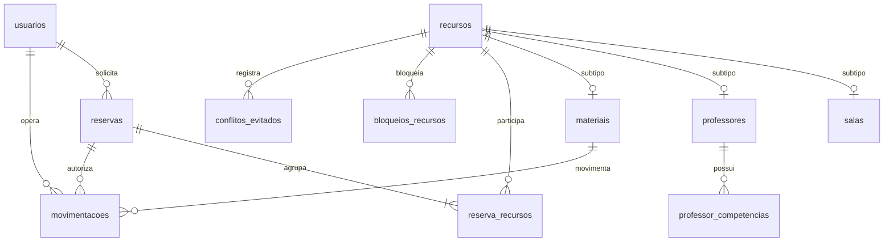

# Persistência, concorrência e integração do item 18

Decisão: MySQL 8.4, InnoDB, Flyway como único autor do esquema, Hibernate validate. UTC DATETIME(6), expediente America/Sao_Paulo. Entidade JPA ReservaEntidade separada de Reserva. Escritas da reserva usam JPA; leituras atuais usam JDBC para não depender do cache de primeiro nível. Cadastros, filtros e operações específicas usam JdbcTemplate na mesma transação gerida pelo JpaTransactionManager. Esta escolha reduz a complexidade das consultas de ocupação e usa a mesma conexão transacional; não cria um banco paralelo.

## Protocolo
Criar/editar reserva: lock compartilhado da configuração do expediente, recursos em ordem crescente, ocupações atuais, escrita, auditoria e pendências, commit. Alteração de expediente: lock exclusivo da configuração, validação das reservas ativas, substituição atômica. Recursos distintos não são serializados por lock exclusivo global. Manutenção e movimentação bloqueiam o recurso antes de conferir disponibilidade. Bloqueios e devoluções são cancelados/concluídos logicamente.

Na edição, mudança no conjunto de recursos entre leituras aborta com AlteracaoConcorrenteException; não se adquire outro conjunto mantendo locks de uma tentativa anterior. Exceções de domínio causam rollback. ConflitosMysql agenda sincronização que grava em REQUIRES_NEW somente após rollback e liberação dos locks, evitando FK/locks entre transações externa e interna.

Retirada aberta é representada como `[retirado_em,Instant.MAX)` exclusivamente no domínio. A coluna gerada `recurso_aberto` e sua UNIQUE impõem uma retirada aberta por material, inclusive contra gravações que contornem o serviço. FKs apontam para materiais, reserva e operadores. O serviço confirma o vínculo com a reserva no instante da retirada. Cancelar/encerrar a reserva não apaga movimentações nem libera uma unidade sem devolução.

## Modelo ER

Subtipos usam PK/FK composta com discriminador CHECK; uma escrita do cadastro cria base/subtipo atomicamente. SQL manual ainda pode criar uma base sem subtipo; todas as escritas de cadastro devem passar pelo serviço. Professor não exige conta de acesso. Usuários mínimos existem somente para FKs; perfis/login serão acrescentados por Débora.

## Reversão
A criação é `V1__item18.sql`. Migrações aplicadas não devem ser editadas após publicação. DDL MySQL causa commits implícitos: ROLLBACK da transação não desfaz CREATE TABLE. O script em `docs/integracao/rollback-item18.sql` é exclusivamente para uma base descartável vazia de dependências posteriores; perde dados. Para uma base com histórico, restaurar backup ou publicar migração compensatória revisada. Nunca automatizar clean em produção.
