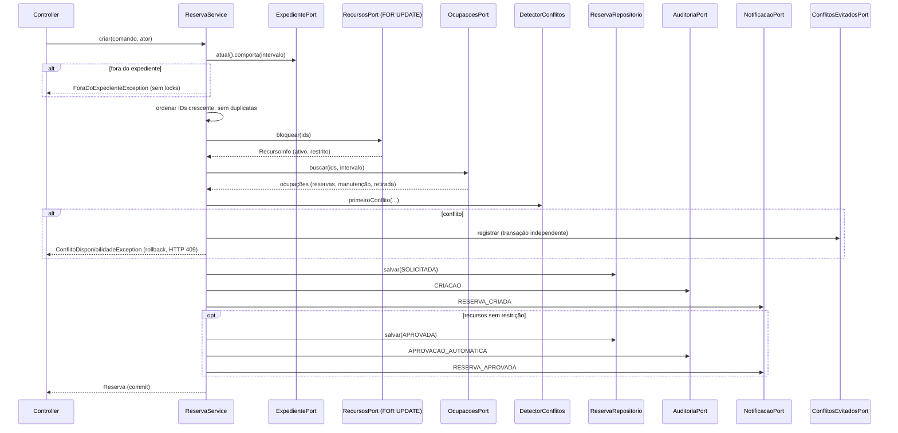
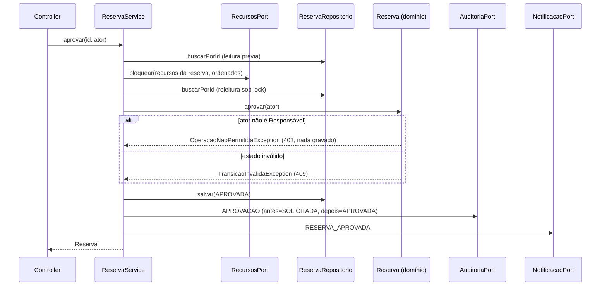

# Sequências críticas de reserva

**Estado: PROPOSTO** — espelha o `ReservaService` e o ADR-003. Código: `br.senac.recursos.reserva.aplicacao.ReservaService`.

## Criar reserva (RF04, RF05, RF06)

## Aprovar ou rejeitar reserva restrita (RF07)

Cancelar, iniciar, concluir e registrar não comparecimento seguem o mesmo desenho do segundo diagrama, mudando apenas a regra de domínio chamada.
